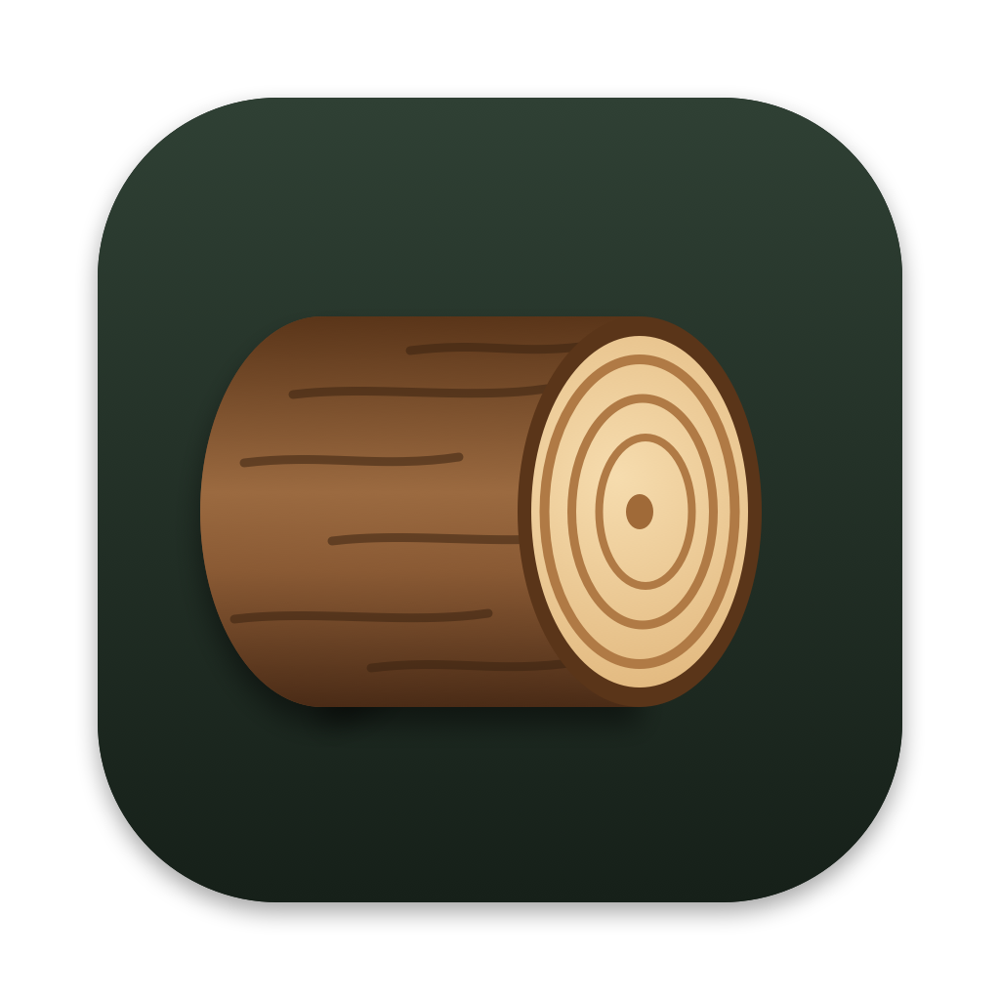

<p align="center">
  
</p>

<h1 align="center">Log</h1>

<p align="center">
  <b>Record both sides of any call on your Mac.</b><br>
  You and them, on separate tracks, from Zoom, Meet, Teams, WhatsApp or anything else that makes sound.
</p>

<p align="center">
  <a href="https://github.com/berttaylor/log/releases/latest/download/Log.dmg"><b>Download Log.dmg</b></a>
  &nbsp;·&nbsp; macOS 15 or later &nbsp;·&nbsp; Apple silicon and Intel &nbsp;·&nbsp; Free and open source
</p>

---

Recording a call on a Mac is awkward. macOS lets you record your microphone or your screen, but not the sound your Mac is playing. Every call app has its own recorder, often only for the host, often with a bot that joins the call and announces itself.

Log fixes that in one place. It sits in your menu bar, and when you click **Record** it captures two things at once:

- **Them:** everything your Mac plays, whichever app it comes from and whether it goes to speakers, headphones or AirPods.
- **You:** your microphone.

The two tracks are lined up to the same start time, so you get a clean record of the whole conversation. You don't need to change settings in each app, join a bot to the call or install an audio driver.

Turn on **Capture Screens** and Log also records every display you have connected, at one frame a second. If you're presenting on one screen with the call on another, you get your slides, the faces and chat of the people asking questions, and what everyone said, all on one timeline.

## Good for

- **Interview practice.** Record mock interviews and real ones, then listen back to how you actually answered.
- **Any video call.** Zoom, Google Meet, Microsoft Teams, Slack huddles, WhatsApp, FaceTime, Discord, Skype. One way of recording that works for all of them.
- **Feeding calls to AI.** Every call lands in the same folder layout with the same file names, so a script or an agent can pick it up. Your voice and theirs are on separate tracks, so a transcript knows who said what without guessing. Use it for summaries, action items, or coaching on how you come across.
- **Presentations and demos.** Capture your slides, the questions and your answers together.
- **Sales and customer calls.** Go back over objections, pricing questions and promises made.
- **User research.** Keep the interview and the screen the participant shared, without a research tool joining the call.
- **Pair programming and support sessions.** Keep the screen share and the explanation that went with it.
- **Podcasts and remote conversations.** Separate tracks for you and your guest make editing easier.
- **Lessons, coaching and language classes.** Keep the session so you can review it later.
- **Webinars and online talks.** Anything that plays on your Mac gets recorded, even if you never speak.

## How it works

1. Click the log icon in the menu bar.
2. Choose how long to record: 30 minutes up to 2½ hours. Log stops on its own when the time is up, or when you click **Stop now**.
3. Click **Show Recordings** to find the files.

While recording, the icon fills in. Nothing else changes, so it gives nothing away if you're sharing your screen. You can turn on **Show Timer in Menu Bar** to see a countdown.

Each recording gets its own folder:

```
~/Downloads/Log/2026-11-19_14-30-00/
  me.m4a         your microphone
  them.m4a       everything your Mac played
  call.m4a       both together: you on the left, them on the right
  screen-1.mp4   each display at one frame a second (if Capture Screens is on)
  screen-2.mp4
```

Some details:

- **Built-in mic first.** If your Mac has a built-in mic, Log uses it even when AirPods are connected. Recording from AirPods switches them to a lower-quality call mode, which would make the call sound worse for you.
- **Screens stay readable.** Each display is recorded at its full resolution, up to 2560 pixels wide. One frame a second is enough to follow slides, code and documents, and it keeps an hour of video small.
- **Safe with your disk.** Log won't start with less than 5 GB free, and it stops and saves if space drops below that during a call.
- **Safe when you quit.** Quitting, logging out or shutting down mid-call still saves everything recorded so far.
- **Open at login** is off until you turn it on in the menu.

## Install

1. [Download Log.dmg](https://github.com/berttaylor/log/releases/latest/download/Log.dmg), open it and drag **Log** into **Applications**.
2. Open Log. Log isn't notarized by Apple, so the first time macOS will say it can't check it. Go to **System Settings > Privacy & Security**, scroll down and click **Open Anyway**.
3. Make your first recording. macOS will ask you to allow **Microphone** and **Screen & System Audio Recording**. Allow both. Log needs screen recording permission to hear your Mac's audio, even if you never record screens.

If you prefer the terminal, you can skip step 2 with:

```sh
xattr -dr com.apple.quarantine /Applications/Log.app
```

## Build from source

You need macOS 15 or later and the Xcode command line tools (`xcode-select --install`). The app is one Swift file with no dependencies.

```sh
git clone https://github.com/berttaylor/log.git
cd log
./build.sh       # builds build/Log.app
./build.sh dmg   # also builds build/Log.dmg
```

To try recording without the menu bar, run it from a terminal:

```sh
build/Log.app/Contents/MacOS/Log --test 10 screens
```

This records 10 seconds to `~/Downloads/Log/test/` and prints the folder. macOS treats the recording as coming from your terminal app, so the terminal needs the same two permissions.

Log uses ScreenCaptureKit for screens, system audio and the mic, and AVFoundation to write the files. Everything stays on your Mac. Log has no network code, analytics or accounts.

## Recording other people

Tell people when you're recording them, and only record calls you're allowed to. The rules differ by country and by company.

## License

[MIT](LICENSE)
